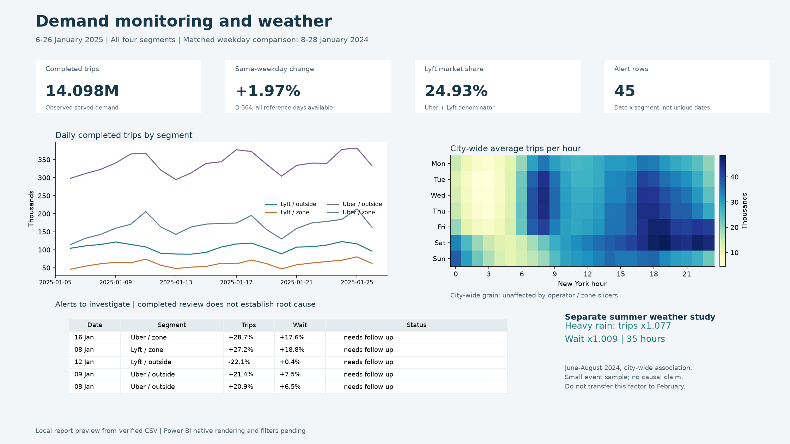
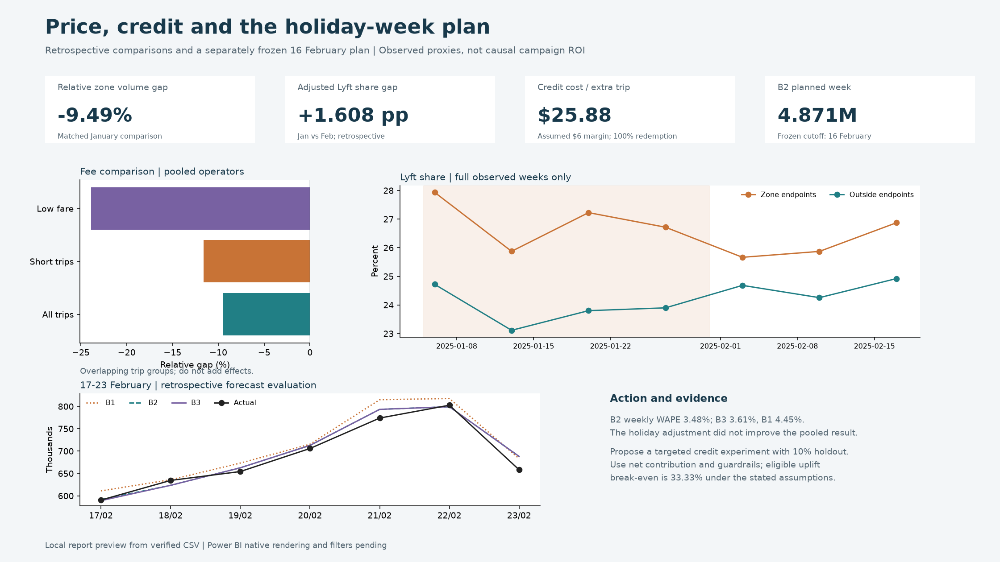

# Urban Mobility Demand Planning

Portfolio chuyến hoàn thành Uber/Lyft tại NYC: phí vùng trung tâm, credit, thời tiết và dự báo tuần có lễ. Có notebook tự chứa, Excel hòa vốn, hai trang preview, memo tiếng Anh và bản nguồn Power BI. **PBIX và kiểm tra Power BI native còn chờ môi trường phù hợp; chưa xuất bản Power BI/Microsoft 365.** Repository GitHub public: [handonn2000/urban-mobility-planning](https://github.com/handonn2000/urban-mobility-planning).

## 1. Câu hỏi và bối cảnh

Phí $1,50 từ 05/01/2025, credit của Lyft và mưa liên hệ thế nào với nhu cầu được phục vụ, và cần lập kế hoạch bao nhiêu chuyến cho 17-23/02? Phạm vi chính: 01/2024, 01/2025, 02/2025; bốn phân khúc = Uber/Lyft × endpoint chạm vùng/ngoài vùng. Riêng mưa dùng thêm 06-08/2024, chọn từ thời tiết trước khi xem kết quả chuyến. Không dùng machine learning.

## 2. Nguồn và ngày tải

Nguồn tải ngày **14/10/2026**, có URL, thời điểm UTC, số byte và SHA-256 trong [manifest](data/external/source_manifest.json).

| Nguồn | Nội dung và phạm vi |
|---|---|
| [NYC TLC](https://www.nyc.gov/site/tlc/about/tlc-trip-record-data.page) | HVFHV Parquet cho ba tháng chính và ba tháng mưa; taxi zone lookup |
| [Open-Meteo Historical](https://open-meteo.com/en/docs/historical-weather-api) | ERA5 tại Central Park, giờ New York; dữ liệu hồi cứu |
| Python `holidays` | Lịch lễ Mỹ 2024-2025 |
| [Lyft](https://www.lyft.com/blog/posts/navigating-the-new-nyc-congestion-fee-with-lyft) | $1,50 future credit, phát 05-31/01, hiệu lực một tuần; có thể dùng ngoài vùng/Citi Bike |

Raw chính có 59.409.057 chuyến. Sáu Parquet tổng khoảng 2,85 GB; không nằm trong gói bàn giao. [Báo cáo nguồn](docs/source_data_report.md).

## 3. Quy tắc và nhãn vùng

- Ngày/giờ theo request, giờ New York. Giữ **59.407.013 chuyến**; loại 2.038 request ngoài phạm vi và sáu endpoint không xác định.
- Giữ volume khi chỉ một metric giá/chờ không hợp lệ; tiền và chờ có mẫu hợp lệ riêng. Hai tổng tiền dùng cùng mẫu kinh tế.
- Suy 38 zone từ tỷ lệ phí ≥95% trong 05-31/01; endpoint đón hoặc trả thuộc danh sách thì chạm vùng. Không nhận biết đầy đủ chuyến xuyên vùng.
- Chuyến ngắn <2 dặm; giá thấp ≤$11,63, ngưỡng cố định từ cước dương 01/2024. Nhóm có thể chồng lấn.
- Forecast cutoff hết 16/02: chỉ đếm chuyến đã hoàn thành trước 17/02. Loại 9.961 chuyến hoàn thành sau mốc khỏi history, không sửa raw hoặc bảng hồi cứu.

[Chất lượng dữ liệu](docs/trip_data_quality.md), [định nghĩa bảng/mẫu số](docs/analysis_table_dictionary.md), [cutoff](docs/holiday_week_forecast_guide.md).

## 4. Luồng xử lý và sản phẩm

Raw bất biến → DuckDB SQL → bảng nhỏ → notebook → dữ liệu/mô hình báo cáo → memo và demo. Weather city-wide có grain riêng; forecast plan tách actual/evaluation.

```text
data/external/      nguồn bổ sung và manifest
data/processed/     bảng phân tích và đối chiếu
sql/               truy vấn theo nội dung
scripts/           CLI tùy chọn
notebooks/         notebook độc lập
excel/             mô hình hòa vốn
powerbi/           Power BI project: TMDL model, PBIR report, CSV nhúng
reports/           preview, biểu đồ và PDF
docs/              phương pháp, bằng chứng, memo, demo
```

[Power BI project (PBIP, TMDL + PBIR)](powerbi/UrbanMobility.pbip), [hướng dẫn mở và mô tả model](docs/powerbi_handoff.md), [demo 3 phút](docs/demo_walkthrough.md).

## 5. Cách chạy lại

**Colab/Jupyter:** upload riêng [notebook](notebooks/urban_mobility_demand_analysis.ipynb) (tiếng Anh, theo thứ tự slide báo cáo: dữ liệu, phí, credit, thời tiết và cảnh báo, dự báo, đề xuất), chọn **Run all**. Notebook tự cài thư viện còn thiếu, tải khoảng 2,9 GB dữ liệu công khai vào `urban-mobility-data/` ở lần chạy đầu, dùng lại ở các lần sau, và xuất các bảng chính vào `urban-mobility-data/outputs/`. Không cần clone repo; trên Colab, mount Drive và đổi `ROOT` nếu muốn giữ dữ liệu giữa các phiên.

Notebook chỉ tái lập các số có trong slide báo cáo (bảng ngày, nhãn vùng, phí, credit, hệ số mưa mùa hè, cảnh báo, dự báo); phân tích mở rộng (GMV, bootstrap, cỡ mẫu thử nghiệm) và các phần đóng gói như Power BI, memo PDF, Excel và file kiểm tra nằm trong `scripts/`.

**CLI:**

```sh
python3 -m venv .venv
.venv/bin/python -m pip install -r requirements.txt
.venv/bin/python scripts/prepare_source_data.py
.venv/bin/python scripts/clean_and_aggregate_trips.py
.venv/bin/python scripts/analyze_weather_and_alerts.py
.venv/bin/python scripts/analyze_congestion_fee.py
.venv/bin/python scripts/analyze_lyft_credit.py
.venv/bin/python scripts/forecast_holiday_week.py
.venv/bin/python scripts/analyze_marketplace_extensions.py
.venv/bin/python scripts/prepare_reporting_pack.py
.venv/bin/python scripts/build_powerbi_project.py
```

Chỉ kiểm tra nguồn: `scripts/prepare_source_data.py --validate-only`. Tạo lại PDF tùy chọn: cài `reporting-requirements.txt`, rồi chạy `scripts/render_planning_memo.py`. Đây không phải dependency của notebook. PBIP dùng snapshot CSV nhúng; tạo lại bằng builder sau khi cập nhật phân tích, không tự refresh TLC/cloud.

## 6. Kết quả và đối chiếu nghiên cứu

| Phần | Kết quả thật | Cách đọc |
|---|---|---|
| Phí | Relative zone gap **−9,49%** (bootstrap theo ngày −10,9% đến −8,0%); nhưng **trước phí 02–04/01 đã là −13,85%** | Thiết kế hiện tại không tách được phần do phí; cần dữ liệu 11–12 để kiểm tra xu hướng trước |
| Số chuyến và giá | 01/2024→01/2025: chuyến +1,97%, giá TB +0,73%; Uber chạm vùng giá +9,2%, chuyến −7,8%; Lyft chạm vùng giá −5,8%, chuyến +5,8% | Chuyển dịch giữa hai hãng đi cùng thay đổi giá; quan sát, chưa nhân quả |
| Chi phí credit | Tối đa 5,9% GMV proxy Lyft chạm vùng (2,5% toàn Lyft) nếu dùng hết | Đặt cạnh mức 10,9% GMV của Grab để có cùng thước đo; phạm vi khác nhau |
| Cảnh báo | Dải 2,5 độ lệch chuẩn quanh dự báo: **118 → 9** cảnh báo, 7 giải thích được bằng lễ hoặc thời tiết ở ngày tham chiếu | Ngưỡng ±7% cũ chỉ bằng khoảng 1,1–1,4 lần nhiễu thông thường |
| Credit | Share gap **+1,608 pp**; uplift quy đổi **6,15%** | Proxy quan sát, chưa có ROI thật |
| Kinh tế | **$25,88/chuyến thêm** mặc định | Giả định m=$6, redemption=100%, credit đại trà |
| Mưa >2 mm/h mùa hè | Chuyến ×**1,077**, chờ ×**1,009**; 35 giờ, 14 đợt | Liên hệ city-wide; không chuyển sang February |
| Forecast | WAPE **B2 3,48%**, B3 3,61%, B1 4,45% | B2 chốt trước; winner hồi cứu tách memo cutoff |

[Bổ sung theo cách Grab đo marketplace](docs/marketplace_extensions_report.md) (kiểm tra trước phí, cây metric, chi phí credit, cảnh báo theo dự báo, [cỡ mẫu và switchback](docs/experiment_design_addendum.md)). [Phí và so nghiên cứu Zhang/Sang/Wu](docs/congestion_fee_report.md) giải thích khác biệt thiết kế/mẫu số, không tái lập hoặc ép độ lớn khớp nghiên cứu. [Credit](docs/lyft_credit_report.md), [thời tiết](docs/weather_and_alerts_report.md), [forecast](docs/holiday_week_forecast_report.md), [Excel](excel/lyft_credit_breakeven.xlsx).

[Memo tiếng Anh một trang tại cutoff](reports/mobility_planning_memo.pdf), [bản đọc hồi cứu riêng](docs/mobility_retrospective_review.md).

Hai ảnh là **preview cục bộ từ CSV đã kiểm tra**, chưa phải ảnh chụp Power BI native:





## 7. Giới hạn và trạng thái bàn giao

Không có booking hủy/thất bại, số tài xế, customer ID, redemption, retention hoặc đủ chi phí để đo contribution thật. Nhãn vùng là proxy; đối chứng có spillover: 4,7–5,4% chuyến bị thu phí nằm ở nhóm ngoài vùng. Chênh lệch trong/ngoài vùng đã có trước ngày thu phí, nên −9,49% không được đọc là tác động của phí. So quan sát chưa xác nhận nhân quả, sensitivity không phải confidence interval.

Forecast giả định record đã có tại cutoff; TLC monthly release không phải live feed. Hệ số MLK dựa trên một ngày và chỉ có một tuần test. ERA5 là hồi cứu, không phải forecast có sẵn tại cutoff.

PBIP mới (TMDL + PBIR, 4 trang) đã qua kiểm tra cú pháp TMDL, schema Microsoft, `pbiplint` (0 lỗi) và đối chiếu số; **refresh, DAX và hiển thị cần mở bằng Power BI Desktop trên Windows**, sau đó Save as .pbix nếu cần.

## 8. Cách dùng AI và kiểm chứng

AI hỗ trợ SQL/Python, giả định, DAX/mô hình dự thảo và đóng gói. Số sinh từ chạy thật; không lấy ví dụ trong deck làm kết quả. [AI log](docs/ai-log.md) ghi quyết định, phát hiện, giới hạn; [notebook execution](docs/notebook_execution.json) ghi điều kiện chạy và bảng đối chiếu số với repo. Đã thử Jupyter độc lập với source cache; chưa truy cập runtime Google Colab thực tế.

Người trình bày cần tự giải thích nhãn zone, counterfactual, ví dụ 100 chuyến credit và WAPE từ tử số/mẫu số thật. Hồ sơ không ghi rằng người dùng đã tự làm các bước này. Kế hoạch/tiêu chí nội bộ nằm riêng, không đưa số module/gate vào code/notebook.
